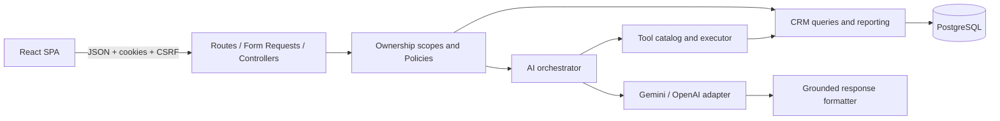
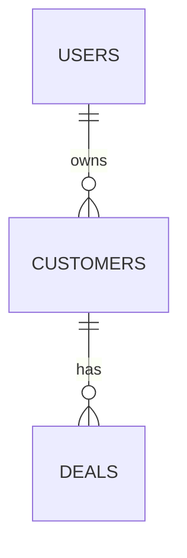

<h1 align="center">7B AHMED TAMER · Backend API</h1>

<p align="center">A small CRM with explicit ownership, exact sales calculations, and grounded AI assistance.</p>

<p align="center">
  
  
  
</p>

<p align="center"><a href="https://github.com/tamourax/CRMfrontend">React frontend</a> · <a href="docs/API.md">API reference</a> · <a href="docs/ARCHITECTURE.md">Architecture & ERD</a> · <a href="docs/REFACTOR.md">Refactor notes</a></p>

## Contents

- [Quick start](#quick-start)
- [Demo accounts](#demo-accounts)
- [Architecture](#architecture)
- [Database relationships](#database-relationships)
- [Project structure](#project-structure)
- [AI provider configuration](#ai-provider-configuration)
- [Tests and commands](#tests-and-commands)
- [Refactor and branches](#refactor-and-branches)
- [Documentation](#documentation)

## Quick start

### 1. Requirements

| Dependency | Tested version / configuration |
|---|---|
| PHP | 8.4, with `pdo_pgsql`, `pdo`, `mbstring`, `openssl`, `curl`, `fileinfo`, `xml`, `ctype`, `tokenizer`, `dom` |
| Composer | 2 |
| PostgreSQL | 17 |
| Node.js | Only needed for the separate React frontend |

Check PHP with `php -v`, `php --ini`, and `php -m`. On Windows, enable `extension=pdo_pgsql` in the loaded PHP configuration and restart PHP if necessary.

### 2. Install and prepare PostgreSQL

```sh
git clone https://github.com/tamourax/CRMbackend.git backend
cd backend
composer install
php scripts/setup-local.php
php artisan migrate --seed
```

The local helper creates a restricted application login, the `orbit_crm` and disposable `orbit_crm_test` databases, an application key, and ignored `.env` / `.env.testing` files. Existing local provider settings are preserved. It never changes PostgreSQL authentication rules or grants the application superuser privileges.

**Default helper connection:** `127.0.0.1:5433`, administrator `postgres`, matching the assessment workstation. PostgreSQL installations using port `5432` need an override:

```sh
# Linux / macOS
PGPORT=5432 php scripts/setup-local.php
```

```powershell
# Windows PowerShell
$env:PGPORT = '5432'
php scripts/setup-local.php
```

Other optional administrator connection variables are `PGHOST`, `PGUSER`, and `PGPASSWORD`. Supply them locally if your PostgreSQL installation requires a password; never put it in source code.

<details>
<summary><strong>Manual database/environment setup</strong></summary>

Create application-owned PostgreSQL databases for development and tests. Copy `.env.example` to `.env`, configure `DB_*`, run `php artisan key:generate`, then `php artisan migrate --seed`. Create a separate `.env.testing` with a disposable database name ending in `_test`.

The example environment uses conventional port `5432`. Do not point tests at development or production data: test migrations reset their configured database. The test base class verifies PostgreSQL and the `_test` suffix before migration.

</details>

### 3. Start the API and frontend

```sh
php artisan serve --host=127.0.0.1 --port=8000
```

API: **[http://localhost:8000](http://localhost:8000)** · Health: **[http://localhost:8000/up](http://localhost:8000/up)**

In another terminal, follow the [frontend quick start](https://github.com/tamourax/CRMfrontend#quick-start) and open **[http://localhost:5173](http://localhost:5173)**. Clone the frontend as a sibling directory named `frontend` when using its Playwright configuration.

Use **localhost** consistently in both browser URLs. Mixing it with `127.0.0.1` prevents the SPA from sharing session/CSRF cookies correctly.

## Demo accounts

| Workspace | Username / email | Demo password |
|---|---|---|
| Alex Morgan | `alex@orbit.example` | `OrbitDemo!2026` |
| Sarah Chen | `sarah@orbit.example` | `OrbitDemo!2026` |

These are public, fictional seed credentials, not production credentials. Each account owns **10 customers and 30 deals**. The seed covers all six stages, customers without deals, missing notes/loss reasons, and past/current/future closing dates. It is idempotent and restricted to local/testing environments. Re-seeding refreshes dates relative to the current Cairo calendar.

## Architecture



The backend is a **single Laravel application with service boundaries**, using constructor injection. Controllers handle HTTP coordination, Form Requests validate input, Eloquent relationships/scopes and Policies enforce ownership, and services own queries, calculations, and AI workflows.

| Component | Responsibility |
|---|---|
| `CrmQueries` | Authenticated customer/deal queries, filtering, sorting |
| `SalesReportService` | Exact database totals, stage statistics, customer rankings |
| `AiAssistant` | Coordinate customer summary, deal questions, and report summary |
| `DealToolCatalog` | Tool definitions, allowed arguments, limits, date validation |
| `DealToolExecutor` | Validate a selected tool and execute scoped queries |
| `ContextBuilder` | Minimize provider context and preserve authoritative render values |
| `GroundedResponseFormatter` | Validate model output, sources, and numeric placeholders |
| `AiProviderInterface` | Replaceable Gemini/OpenAI transport boundary |

The model has no database connection, arbitrary SQL tool, write capability, or ownership override. Laravel calculates every statistic. AI prose uses server-filled fact placeholders and authorized source references; recommendations still need human review.

Authentication uses **Laravel Sanctum session cookies**, not browser-stored bearer tokens. Login rotates the session ID; logout invalidates it. Every list, detail, report, and AI query is scoped to the authenticated user. Foreign record IDs return `404`.

## Database relationships



- `customers.user_id` references `users.id`; `deals.customer_id` references `customers.id`.
- Deal ownership is inherited from its customer, avoiding duplicate owner fields.
- Foreign keys restrict deletion; check constraints enforce supported stages/statuses and nonnegative values.
- Values use PostgreSQL `NUMERIC(14,2)` and decimal strings in JSON. Currency is USD.
- Open pipeline includes **Lead, Qualified, Proposal, Negotiation**; Won and Lost are separate.
- Expected dates use the **Africa/Cairo** calendar. A current snapshot cannot establish historical growth or realized revenue.

See the [full ERD and metric definitions](docs/ARCHITECTURE.md).

## Project structure

```text
app/
├── Http/
│   ├── Controllers/           # HTTP orchestration
│   ├── Requests/              # Input validation
│   └── Resources/             # API representations
├── Models/                    # Eloquent entities and ownership scopes
├── Policies/                  # Record authorization
├── Providers/                 # Dependency binding and rate limits
└── Services/
    ├── CrmQueries.php
    ├── SalesReportService.php
    └── Ai/                    # Orchestration, tools, context, providers, verification
database/
├── migrations/                # PostgreSQL schema and constraints
├── factories/                 # Controlled test data
└── seeders/                   # Fictional demo dataset
routes/                       # Session and REST endpoints
config/                       # Database, session, CORS, AI configuration
tests/                        # API, service, provider, and opt-in live tests
scripts/setup-local.php       # Local-only database/environment helper
docs/                         # Technical guides and refactor record
```

## AI provider configuration

Set one provider in the **backend** `.env`:

```dotenv
# Gemini
AI_PROVIDER=gemini
GEMINI_API_KEY=
GEMINI_MODEL=gemini-3.5-flash-lite
```

```dotenv
# Or OpenAI
AI_PROVIDER=openai
OPENAI_API_KEY=
OPENAI_MODEL=gpt-5.4-mini
```

Then run `php artisan config:clear` and restart the backend server. Refresh the frontend to reload its configuration status. A developer's local key is never included in a repository checkout. Missing keys and provider errors return an honest `503`; fakes are test-only.

Gemini allows one retry for received HTTP `500/502/503/504`, within a shared 55-second question budget and 25-second per-attempt limit. Authentication, quota, and network-timeout failures are not automatically retried. OpenAI requests use `store=false`; Gemini calls are stateless. Review the chosen provider's retention/privacy settings before sending real customer data.

If local PHP lacks trusted CA configuration, set `AI_CA_BUNDLE` to an existing trusted PEM file. TLS verification remains enabled. Leave it blank on correctly configured systems; never disable verification to make a request succeed.

### Environment reference

| Variables | Purpose |
|---|---|
| `APP_KEY`, `APP_ENV`, `APP_DEBUG`, `APP_URL` | Encryption, environment, safe errors, backend URL |
| `FRONTEND_URL`, `SANCTUM_STATEFUL_DOMAINS` | Exact first-party frontend origin and port |
| `DB_CONNECTION`, `DB_HOST`, `DB_PORT`, `DB_DATABASE`, `DB_USERNAME`, `DB_PASSWORD` | PostgreSQL connection |
| `SESSION_DRIVER`, `SESSION_ENCRYPT`, `SESSION_DOMAIN`, `SESSION_SECURE_COOKIE`, `SESSION_SAME_SITE` | Session storage and cookies |
| `CACHE_STORE` | Database locally; array during tests |
| `AI_PROVIDER`, `OPENAI_API_KEY`, `OPENAI_MODEL` | OpenAI configuration |
| `GEMINI_API_KEY`, `GEMINI_MODEL`, `AI_CA_BUNDLE` | Gemini and optional CA configuration |

Only `.env.example` is tracked. Never commit actual keys, passwords, `.env.testing`, or sessions.

## Tests and commands

| Command | Purpose |
|---|---|
| `php artisan serve --host=127.0.0.1 --port=8000` | Start the API |
| `php artisan migrate --seed` | Create schema and demo data |
| `php artisan test --compact` | 41 offline tests; 4 live tests skipped by default |
| `php vendor/bin/pint --format agent` | Format PHP |
| `composer validate --strict` | Validate the dependency manifest |
| `composer audit` | Dependency audit |

Tests use **PostgreSQL**, not SQLite. They cover authentication, CORS, ownership/IDOR, customer/deal relationships, exact cents, calendar boundaries, filters, database constraints, AI tools, source/fact verification, provider errors, and extracted service boundaries.

Opt-in live evaluation uses synthetic test fixtures and consumes provider quota:

```sh
# Linux / macOS
RUN_LIVE_AI=1 php artisan test --compact tests/Feature/LiveAiTest.php
```

In PowerShell, set `$env:RUN_LIVE_AI='1'`, run the test command, then `Remove-Item Env:RUN_LIVE_AI`. Run test processes sequentially against the shared test database. External model availability can fail a live run independently of offline correctness. [Testing details](docs/TESTING.md).

## Refactor and branches

The refactor separated tool definition/validation, query execution, context construction, and response verification from the original mixed AI service. The public HTTP contract, ownership rules, calculations, provider interface, and seeded data were preserved. [Before/after decisions and verification](docs/REFACTOR.md).

| Branch | Responsibility |
|---|---|
| [`refactor/ai-service-boundaries`](https://github.com/tamourax/CRMbackend/tree/refactor/ai-service-boundaries) | AI service extraction and direct boundary regression tests |
| [`docs/architecture-readme`](https://github.com/tamourax/CRMbackend/tree/docs/architecture-readme) | Setup, architecture, structure, and refactor documentation |
| `main` | Integrated API, using explicit merge commits |

Branches are retained on GitHub. View the actual graph with `git log --graph --oneline --decorate --all`.

## Documentation

| Guide | Contents |
|---|---|
| [Architecture & ERD](docs/ARCHITECTURE.md) | Data flow, relationships, metrics, design choices |
| [API reference](docs/API.md) | Endpoints, filters, payloads, errors |
| [Refactor record](docs/REFACTOR.md) | Responsibilities, compatibility, branch workflow |
| [Testing](docs/TESTING.md) | Automated layers, fixtures, live acceptance |
| [Demo](docs/DEMO.md) | Walkthrough and assessment questions |
| [AI-assisted development](docs/AI_USAGE.md) | Generation, review, candidate ownership checklist |
| [Arabic discussion guide](docs/REVIEW_GUIDE_AR.md) | شرح القرارات للمناقشة الفنية |
| [Security notes](docs/SECURITY.md) | Privacy boundaries and retired historical local credentials |

Production needs HTTPS, secure cookies, private PostgreSQL networking, individual credentials, backups, and removal of demo accounts. CRUD writes, admin roles, stored conversations, historical analytics, streaming, and hosted deployment are outside this assessment version.
