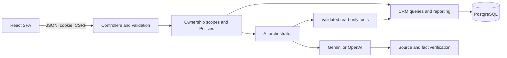
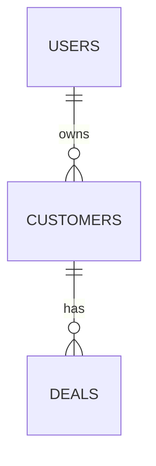

# 7B AHMED TAMER — CRM Backend

A Laravel API for an Egyptian sales CRM with EGP reporting, Arabic/English records, and an AI assistant grounded in authorized database data.

[React frontend](https://github.com/tamourax/CRMfrontend) · [Full setup](docs/SETUP.md) · [Architecture & ERD](docs/ARCHITECTURE.md) · [API](docs/API.md) · [شرح بالعربي](docs/REVIEW_GUIDE_AR.md)

## What is the project?

| Assessment story | Implemented journey |
| --- | --- |
| Customer management | Search/filter customers; open contact/company details, notes, and associated deals |
| Deal management | Filter/sort opportunities; inspect project overview, value, stage, expected close, and customer |
| Customer AI summary | Summarize the authorized profile, notes, relationship, deals, opportunities, and risks |
| Deal assistant | Ask independent questions; Laravel validates and executes bounded queries before AI writes an answer |
| Sales report summary | Display database-calculated statistics and generate a narrative from those same facts |

Stages are Lead, Qualified, Proposal, Negotiation, Won, and Lost. Pipeline includes the first four. Currency is **EGP**; calendar calculations use **Africa/Cairo**. Seeded customer/deal data supports Arabic/English; the React app provides RTL, light/dark mode, and responsive pages.

The core CRM works without an AI key. AI requests then show an explicit unavailable error. Test doubles are confined to tests; the running application has no fake API or simulated AI fallback.

## Versions

| Component | Repository version / requirement |
| --- | --- |
| PHP | Tested **8.5.12**; Composer requires `^8.5` |
| Laravel | **13.42.0**, locked |
| Sanctum | **4.4.0**, locked |
| PHPUnit | **12.5.44**, locked |
| PostgreSQL | **17**, used by CI and documented local setup |
| Composer | **2.x** |
| Node.js | **24.x**, for the separate frontend |

Use `composer install` to reproduce `composer.lock`. The backend has no independently declared application release number; its Git commit identifies the revision. The frontend package declares `1.0.0`. These are repository versions, not claims about the latest upstream releases.

## Quick start

```sh
git clone https://github.com/tamourax/CRMbackend.git backend
git clone https://github.com/tamourax/CRMfrontend.git frontend
cd backend
php -v
composer install
```

Check that `php -v` selects PHP 8.5. Choose **one** database/environment path in [the setup guide](docs/SETUP.md):

- **Manual:** create PostgreSQL databases, copy `.env.example` to `.env`, set your `DB_*` credentials, then run `php artisan key:generate`.
- **Optional local helper:** `php scripts/setup-local.php` creates application/test databases and ignored environment files. It needs PostgreSQL administrator access and defaults to port **5433**; override with `PGPORT` for installations using **5432**. It rewrites local environment files, so use it for initial local setup.

After database/environment setup:

```sh
php artisan migrate --seed
php artisan serve --host=127.0.0.1 --port=8000
```

In another terminal:

```sh
cd frontend
npm ci
npm run dev
```

Open **[http://localhost:5173](http://localhost:5173)**. API: [http://localhost:8000](http://localhost:8000); health: [http://localhost:8000/up](http://localhost:8000/up).

Use `localhost` consistently in browser/API URLs. Match `FRONTEND_URL` and `SANCTUM_STATEFUL_DOMAINS` to the frontend origin. Keep the two repositories as siblings for Playwright. Retain the existing `APP_KEY` on subsequent starts. [Windows PHP, complete commands, environment reference, and troubleshooting](docs/SETUP.md).

## Demo accounts

Run the seeder first. Credentials and records are intentionally public and fictional.

| Workspace | Email | Password |
| --- | --- | --- |
| Ahmed Tamer | `ahmed@7bahmedtamer.example` | `OrbitDemo!2026` |
| Nour Hassan | `nour@7bahmedtamer.example` | `OrbitDemo!2026` |

Each account owns **10 customers and 30 deals** with Egyptian contacts/cities, `+20` phones, reserved `.example` emails, missing-data examples, and all six stages. Re-seeding refreshes expected dates and resets demo passwords. Seeding is restricted to local/testing environments.

Use Ahmed and Nour in separate browser profiles to demonstrate ownership. A new login to the **same account** revokes previous devices. Follow the [application journey](https://github.com/tamourax/CRMfrontend/blob/main/docs/USER_GUIDE.md) or [technical demo script](docs/DEMO.md).

## Architecture



React owns presentation and remote-state caching. Laravel owns validation, authentication, authorization, calculations, and provider calls. PostgreSQL is the source of truth. A single Laravel application with constructor-injected services keeps these boundaries explicit without a generic repository layer.

| Code boundary | Responsibility |
| --- | --- |
| `CustomerController`, `DealController`, `SalesReportController` | Separate domain HTTP actions and resource responses |
| Form Requests, Policies, ownership scopes | Input validation and record authorization |
| `SessionService`, `EnforceActiveSession` | Single-device sessions, expiry, rotation and revocation |
| `CrmQueryService`, `SalesReportService` | Scoped filters, exact aggregates and rankings |
| `HasTranslations` | Shared display-field lookup and canonical fallback |
| `AiAssistant` | Coordinate customer, deal-question, and report workflows |
| `DealToolCatalog`, `DealToolExecutor` | Allowlist, validate, and execute bounded read-only tools |
| `AiContextBuilder` | Minimize provider context; prepare authoritative facts |
| `GroundedResponseFormatter` | Validate sources/placeholders; insert server values |
| `AiProviderInterface` | Interchangeable Gemini/OpenAI transport |

AI has no direct database connection, arbitrary SQL, or write capability. Source allowlists and server-filled numeric placeholders constrain answers; qualitative recommendations still need review. [Architecture, AI flow and metric definitions](docs/ARCHITECTURE.md).

## Database relationships



`customers.user_id` references `users.id`; `deals.customer_id` references `customers.id`. Deal ownership follows its customer. Constraints enforce valid relationships, supported statuses/stages, and nonnegative `NUMERIC(14,2)` money. Responses use decimal strings. Nullable `JSONB` translations hold Arabic display fields. [Full ERD](docs/ARCHITECTURE.md#erd).

## Project structure

```text
app/
  Http/
    Controllers/     Auth, Customer, Deal, SalesReport, AI actions
    Requests/        Login, filters and assistant validation
    Resources/       Customer and deal JSON
    Middleware/      Locale, active-session checks, security headers
  Models/            User, Customer, Deal, ownership relationships
    Concerns/        HasTranslations
  Policies/          Customer/deal authorization
  Providers/         Dependency binding and rate limits
  Services/
    CrmQueryService.php
    SalesReportService.php
    SessionService.php
    Ai/              Orchestration, tools, context, providers, verification
config/              Database, session, CORS and AI configuration
database/            Migrations, seeders and test factories
lang/ar/, lang/en/   Backend messages and stage/status labels
routes/              REST and session endpoints
tests/               API, service, security and provider tests
scripts/             Optional local environment/database helper
docs/                Setup, architecture, API, security and review guides
```

## AI provider configuration

Edit **backend `.env` only**. Choose one provider and fill its key:

```dotenv
# Option A
AI_PROVIDER=openai
OPENAI_API_KEY=replace-with-your-private-openai-key
OPENAI_MODEL=gpt-5.4-mini
```

```dotenv
# Option B
AI_PROVIDER=gemini
GEMINI_API_KEY=replace-with-your-private-gemini-key
GEMINI_MODEL=gemini-3.5-flash-lite
```

Model identifiers above match repository defaults. Use a model your provider account supports and ensure it has quota. The unselected key can stay empty. Never commit keys or put them in frontend `VITE_*` variables.

Run `php artisan config:clear`, restart the API, then reload the browser. `/api/status` checks key presence, not provider connectivity or quota. Generate a summary to exercise a live request. Missing configuration, rate/quota limits, timeouts, and unverifiable output return visible errors.

`AI_CA_BUNDLE` optionally points to a trusted PEM file when local PHP needs explicit TLS trust configuration. Keep certificate verification enabled. [Full environment reference](docs/SETUP.md#environment-reference).

## Security and deployment

Sanctum uses encrypted HttpOnly session cookies and CSRF. New logins revoke earlier devices; renewal rotates both ID and verifier without extending the eight-hour absolute limit. Idle expiry defaults to 30 minutes. No access/refresh bearer tokens are stored in browser JavaScript storage. The UI clears private cache on `401`.

All CRM/report/AI queries are owner-scoped; foreign record IDs return `404`. Login is limited independently per account and IP; AI routes share a per-user limit. Production forces Secure/HttpOnly cookies and disables debug. Passwords are hashed; session payloads are encrypted. AI keys stay on the backend, and contact data is minimized before external calls.

Production still needs HTTPS, frontend-host security headers, database TLS/disk encryption, private networking, backups, secret storage, and removal of demo accounts. Session encryption does not encrypt every CRM column. [Security details and historical credential-handling record](docs/SECURITY.md).

## Tests and commands

| Command | Purpose |
| --- | --- |
| `composer install` | Install locked dependencies |
| `php artisan migrate --seed` | Local schema and demo records |
| `php artisan serve --host=127.0.0.1 --port=8000` | Run local API |
| `php artisan route:list --path=api --except-vendor` | Inspect API |
| `php artisan test --compact` | Offline suite; live tests skipped by default |
| `php vendor/bin/pint --format agent` | Format PHP |
| `composer validate --strict` | Manifest/lock consistency |
| `composer check-platform-reqs` | Active PHP/extensions |
| `composer audit` | Dependency advisories |

Verification on 17 November 2026: **51 default backend tests / 247 assertions**, **16 frontend integration tests**, **3 browser tests**, and a successful frontend build. A separate live Gemini run passed **4 tests / 22 assertions**, including all five assessment questions. Tests require an isolated PostgreSQL database ending in `_test`. [Test environment](docs/TESTING.md) · [Assessment coverage and submission qualifications](docs/ASSESSMENT_REVIEW.md).

## Delivery and review

Both repositories contain complete source, lockfiles, environment templates, and separate CI workflows. Earlier screenshots/recording are available in the frontend repository; the current seeded app is the authoritative demo. CRUD editing, registration, admin roles, persisted chats, historical analytics, streaming, and hosted production deployment are outside this assessment scope.

Feature/refactor/documentation branches are retained, including `refactor/shared-services` and frontend `refactor/shared-ui-and-styles`. History contains fast-forward integration and earlier merge commits. Inspect with `git log --graph --oneline --decorate --all`.

## Documentation map

| Guide | Read it for |
| --- | --- |
| [Setup & environment](docs/SETUP.md) | First install, Windows, manual/helper DB setup, all variables, troubleshooting |
| [Architecture & ERD](docs/ARCHITECTURE.md) | Design choices, data relationships, AI flow and metrics |
| [API reference](docs/API.md) | Endpoints, localization, filters, payloads and errors |
| [Security](docs/SECURITY.md) | Authentication, privacy and deployment boundaries |
| [Testing](docs/TESTING.md) | Isolated test database, commands and live checks |
| [Demo](docs/DEMO.md) | Story walkthrough and reviewer talking points |
| [Arabic discussion guide](docs/REVIEW_GUIDE_AR.md) | شرح المعمارية والقرارات أثناء المناقشة |
| [Refactor](docs/REFACTOR.md) | Shared components/services and compatibility |
| [AI-assisted development](docs/AI_USAGE.md) | Generation requests, review and candidate ownership |
