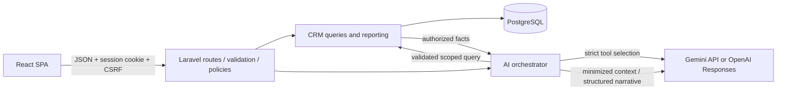
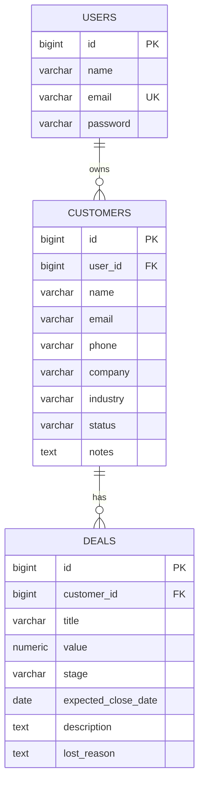

# Architecture and design decisions

## Request and data flow

Separate repositories meet delivery requirements. Controllers coordinate requests, Form Requests validate input, Eloquent ownership scopes and policies enforce authorization, business services calculate reports, Resources shape outbound records, and `AiProviderInterface` isolates external calls. Direct Eloquent queries keep the small application understandable without a redundant repository layer.

The AI service boundaries are explicit: `AiAssistant` coordinates the workflow; `DealToolCatalog` defines and validates tools; `DealToolExecutor` revalidates and executes them for an authenticated user; `ContextBuilder` prepares customer/report contexts; and `GroundedResponseFormatter` verifies model output before inserting server facts. Providers own only external transport. See [the refactor record](REFACTOR.md) for the before/after mapping and compatibility guarantees.

Sanctum uses session cookies and CSRF. React never stores bearer tokens in localStorage. Login regenerates the session ID. Logout invalidates the session, rotates CSRF, cancels queries, and removes private frontend cache entries. CORS permits one configured origin with credentials. Production SPA/API hosts must share the same parent domain or use a same-origin proxy.

## ERD

Domain tables also have timestamps. Users own customers and reach deals through those customers. Deals do not duplicate owner IDs, avoiding contradictory ownership. Detail lookups are scoped before policies execute. Foreign keys restrict deletion; check constraints enforce valid statuses/stages and nonnegative `NUMERIC(14,2)`. Indexed ownership, stage, and close-date columns support lists and assistant queries. Single currency: USD. Database sums and JSON decimal strings preserve exact money values; frontend formatting is presentation only.

## Metric definitions

- Open/active: Lead, Qualified, Proposal, Negotiation.
- Pipeline: sum of open values; Won and Lost excluded.
- Won/lost value: terminal-stage sums, not recognized revenue.
- Top customers: total value across all stages; active-count ranking is a separate tool option.
- This month: inclusive first/last calendar dates in `Africa/Cairo`, using expected close date.
- Overdue: open deals with an expected close before today.
- Win rate: won / (won + lost); zero with no decided deals.
- Reports are current snapshots over all accessible deals. Historical stage changes and actual close dates are absent, so growth trends and realized revenue over time cannot be established.

## Grounded AI

Customer summaries use authorized profile data, minimized notes, aggregates across all associated deals, and at most twenty highest-value deal details. Report summaries reuse exactly the dashboard reporting service. Deal questions select one strict read-only tool; Laravel independently validates its name/arguments, applies the authenticated user, executes scoped queries, then sends results to a separate structured narrative request.

Tools: `search_deals`, `stage_totals`, `top_customers`, `lost_deal_reasons`, `unsupported_question`. There is no arbitrary SQL, ownership parameter, network tool, write tool, or autonomous loop. Detail limits are disclosed; sums/counts cover all matching records, not just the displayed subset. Source keys are server-generated from authorized results. Model-selected sources must be in that set. Numeric narrative claims use `{{fact_key}}` placeholders resolved by Laravel. Unknown facts/sources, literal digits, incomplete output, and malformed responses are rejected. Fact cards always use backend values. Both providers use the same summary contract and prompt rules. Report render values include the actual customer counts, company labels, stage totals, and amounts so supported narrative facts have authoritative placeholders. Date-only assistant questions include all stages unless the user explicitly requests open/active or a particular stage.

These checks constrain numbers and access; they cannot prove the semantics of free-form recommendations. Number words, misleading use of a valid fact, or unsupported qualitative statements remain possible and need live evaluation/human review. Missing reasons remain null. Opportunities are suggestions. No history is invented. Fakes are confined to tests.

## Security/privacy boundaries

- Every list, detail, aggregate, and AI query starts with ownership. Foreign IDs return `404`. Assistant-supplied owner parameters are rejected.
- Validation bounds strings, dates, page sizes, tool limits, output length, and sources. SQL values are parameterized; tool names/sort columns are allowlisted. React escapes text and never executes model HTML.
- Notes and records are untrusted data. Embedded instructions cannot grant permissions; scoped database access is the actual boundary.
- Contact fields are omitted from provider context. Known contact identifiers, detectable emails/phone patterns, and HTML are removed from notes/descriptions; text is truncated. Company/business data can still leave the server, and automatic redaction is not complete DLP. Only synthetic records were used.
- Keys remain in backend environment files. Provider logs include HTTP status only, never raw prompts, keys, or provider error bodies. `store=false` does not exclude provider abuse-monitoring retention.
- Login and AI routes are rate-limited. AI calls have connection/response timeouts and safe `503` errors; the CRM works without AI.
- Local PostgreSQL already used localhost trust authentication; setup did not change it. The app uses a restricted role. Production requires strong database authentication, TLS, private networking, backups, secret management, and removal of public demo accounts.

## Deliberate limits

Chat turns are independent and synchronous: at most one tool-selection and one summary request. No persisted chats, embeddings, vector DB, Redis, queue workers, or streaming are required. OpenAI uses a 25-second per-call timeout. Gemini shares a 55-second overall budget across both phases, with a 25-second per-attempt timeout and one retry only after a received transient server error. No retry is made for quota/authentication errors or network timeouts. Future work: bounded conversation state, sensitive-data-safe audit events, async generation, snapshot-consistent multi-query reports, explicit organization membership, and historical sales events.
