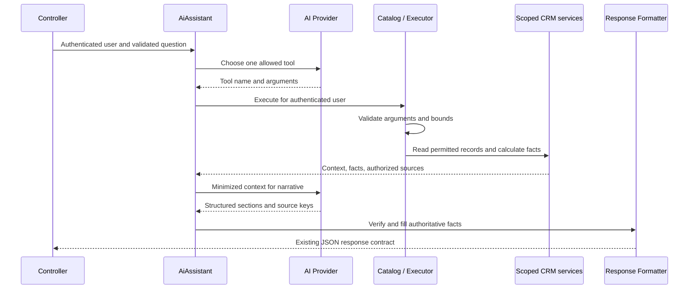

# Backend refactor record

## Objective

Keep the working HTTP API and its access/data guarantees while separating the responsibilities that had accumulated in `AiAssistant`. Use Laravel constructor injection and the existing service structure; add no new framework, dependency, database migration, or generic repository layer.

## Responsibility changes

| Before | After | Reason |
|---|---|---|
| AI service defined schemas and validated model arguments | `DealToolCatalog` | One home for allowed tools, argument rules, and limits |
| AI service executed all deal queries | `DealToolExecutor` | Explicit execution boundary with authenticated ownership |
| Report context was assembled inside orchestration | `ContextBuilder::salesReport` | Keep context minimization and factual render values together |
| AI service parsed sources and substituted numeric facts | `GroundedResponseFormatter` | Verify untrusted output independently of network calls |
| One mixed workflow class | Thin `AiAssistant` facade | Coordinate services and preserve existing callers |

`AiAssistant::tools()` remains a compatibility facade for callers/tests. `DealToolExecutor::execute()` validates its inputs even when invoked without a controller, so moving code does not weaken the trust boundary. Business calculations still live in `CrmQueries` and `SalesReportService`; provider adapters remain behind `AiProviderInterface`.

## Flow after the refactor

## Compatibility

- Endpoints, JSON envelopes, amounts, sources, and missing-configuration behavior are unchanged.
- Users still access only their own customers and associated deals.
- Queries remain parameterized/allowlisted; the model gains no new tools or permissions.
- Report numbers are still SQL-backed decimal strings, not model calculations.
- Invalid facts, sources, and numeric prose are rejected as before.
- Existing migrations, demo accounts, provider settings, and frontend integration remain compatible.

## Verification

The offline backend suite passes 41 tests / 211 assertions. Three added tests invoke extracted boundaries directly: execution must enforce ownership, injected owner arguments must fail without a controller, and formatting must preserve a large exact decimal plus sources/limitations. Existing API/provider tests continue to cover the end-to-end behavior.

Live tests remain opt-in. During verification, a report request encountered a transient provider error; the focused retry passed. This is reported separately from deterministic offline tests.

## Git workflow

`refactor/ai-service-boundaries` groups service extraction and regression tests in separate commits. `docs/architecture-readme` groups setup/architecture/refactor documentation. Merge with `--no-ff` to keep the integration points visible; retain remote branch references. Previously published history is not rewritten.
