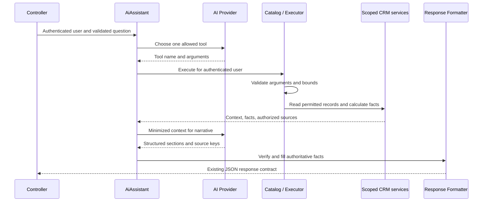

# Backend refactor record

## Objective

Keep the working HTTP API and its access/data guarantees while separating the responsibilities that had accumulated in `AiAssistant`. Use Laravel constructor injection and the existing service structure; add no new framework, dependency, database migration, or generic repository layer.

## Responsibility changes

The shared-code refactor separates customer, deal, and reporting HTTP actions into `CustomerController`, `DealController`, and `SalesReportController` with the same routes, validation, ownership checks, pagination, and resources. `SessionService` now owns the session lifecycle previously shared between the authentication controller and middleware. `HasTranslations` removes duplicate translation lookup from the three models. `CrmQueries` was renamed to `CrmQueryService`, and `ContextBuilder` to `AiContextBuilder`; all callers and review documentation use the new names. No database or response changes are required.

| Before | After | Reason |
|---|---|---|
| AI service defined schemas and validated model arguments | `DealToolCatalog` | One home for allowed tools, argument rules, and limits |
| AI service executed all deal queries | `DealToolExecutor` | Explicit execution boundary with authenticated ownership |
| Report context was assembled inside orchestration | `AiContextBuilder::salesReport` | Keep context minimization and factual render values together |
| AI service parsed sources and substituted numeric facts | `GroundedResponseFormatter` | Verify untrusted output independently of network calls |
| One mixed workflow class | Thin `AiAssistant` facade | Coordinate services and preserve existing callers |

`AiAssistant::tools()` remains a compatibility facade for callers/tests. `DealToolExecutor::execute()` validates its inputs even when invoked without a controller, so moving code does not weaken the trust boundary. Business calculations still live in `CrmQueryService` and `SalesReportService`; provider adapters remain behind `AiProviderInterface`.

## Flow after the refactor

## Compatibility

- Endpoints, JSON envelopes, amounts, sources, and missing-configuration behavior are unchanged.
- Users still access only their own customers and associated deals.
- Queries remain parameterized/allowlisted; the model gains no new tools or permissions.
- Report numbers are still SQL-backed decimal strings, not model calculations.
- Invalid facts, sources, and numeric prose are rejected as before.
- Existing migrations, demo accounts, provider settings, and frontend integration remain compatible.

## Verification

The offline backend suite covers 49 tests / 241 assertions, including direct service boundaries, session revocation/rotation, API ownership, validation, monetary calculations, and provider behavior. Four live provider tests remain opt-in.

Live tests remain opt-in. During verification, a report request encountered a transient provider error; the focused retry passed. This is reported separately from deterministic offline tests.

## Git workflow

`refactor/ai-service-boundaries` groups the earlier AI extraction and boundary tests. `refactor/shared-services` groups the later controller/session/translation refactor. Documentation has its own branches. Remote branch references are retained; integration includes fast-forward updates and earlier merge commits. Inspect the actual graph with `git log --graph --oneline --decorate --all`. Previously published history is not rewritten.
